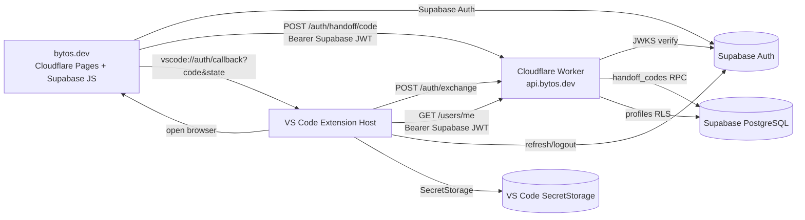
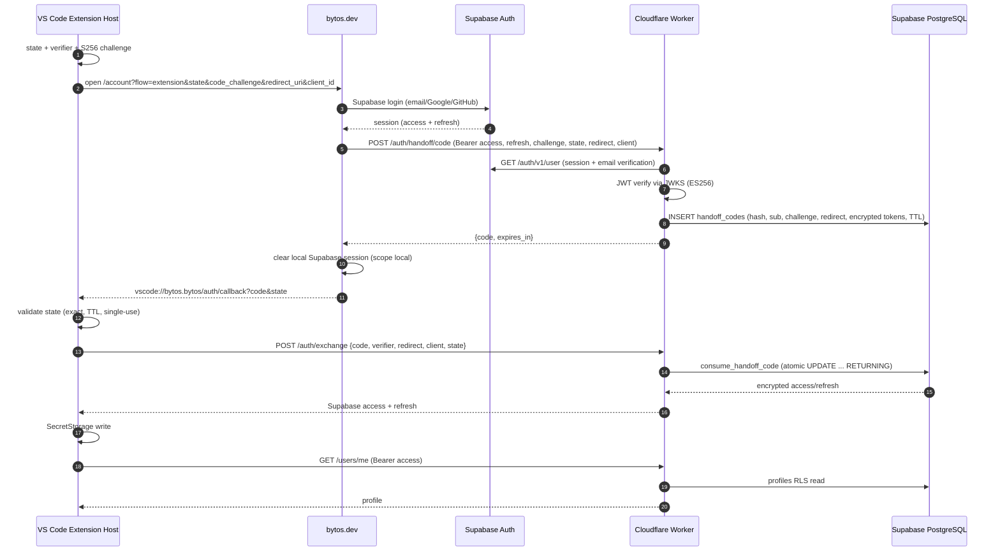

# BYTOS A2 — API CONTRACT & SECURITY DESIGN

**Tarih:** 2026-11-07
**Mod:** Tasarım-only; implementasyon yok
**Durum:** Hiçbir kaynak kodu, uygulama dosyası, migration, DB, Cloudflare/Supabase/DNS/OAuth ayarı değiştirilmedi; deploy/commit/push yapılmadı. Gizli anahtar/token/parola rapora yazılmadı.

> Bu görevde yalnızca talep edilen bu tasarım raporu oluşturuldu. Uygulama kodu, Worker, migration veya yapılandırma dosyası oluşturulmadı.

---

## 1. Executive Summary

Seçilen mimari — **Cloudflare Workers + Supabase Auth + Supabase PostgreSQL** — mevcut Bytos koduyla uyumludur ve en küçük güvenli yol olarak önerilir.

Tasarımın özü:

- **Supabase Auth tek kimlik kaynağıdır.** Worker, Supabase access token'ını **ES256 JWKS** ile yerel olarak doğrular; paylaşılan JWT secret gerekmez.
- **Extension, Supabase access + refresh token'larını doğrudan kullanır.** İkinci bir Bytos token sistemi kurulmaz. Handoff sırasında website, Supabase oturumunu Worker'a bir kerelik devreder; Worker bunu şifreleyip tek kullanımlık code'a bağlar; extension exchange sonrası token'ları **SecretStorage**'a yazar.
- **Web → VS Code flow:** state + PKCE (S256) + tek kullanımlık code + exact redirect URI + client ID + Supabase `sub`/`session_id` binding. URL'de asla token yok.
- **Code storage:** Supabase PostgreSQL + `SECURITY DEFINER` RPC; atomik `UPDATE ... WHERE consumed_at IS NULL ... RETURNING`; KV/DO gerekmez.
- **v1 API:** `POST /api/v1/auth/handoff/code`, `POST /api/v1/auth/exchange`, `GET /api/v1/users/me`. `/auth/refresh` ve `/auth/logout` **gerekli değil**; extension Supabase ile doğrudan refresh/logout yapar. Legacy WorkOS endpoint'leri adaptör olarak korunur.
- **DB v1:** yalnızca `profiles` (mevcut) + `handoff_codes` (yeni). `identity_links`, `user_sessions`, `audit_events` v1'de yok.

**Kritik uyarı:** Website'ın Supabase oturumu extension'a devredilirken **tek sahip** kuralı uygulanmalıdır. Website code aldıktan sonra kendi local Supabase oturumunu temizlemelidir (`signOut({scope:"local"})`); aksi halde aynı refresh token iki istemcide rotation çakışmasına yol açar.

**Verdict:** Tasarım onaya hazır. Implementasyon; Cloudflare/Supabase erişimi, `api.bytos.dev` DNS'i ve website session-ownership kararı verilene kadar **BLOCKED**.

---

## 2. Selected Architecture



| Bileşen | Sorumluluk |
|---|---|
| Cloudflare Worker | API gateway, JWT doğrulama, handoff code issuance/exchange, `users/me`, rate limit, CORS |
| Supabase Auth | Kimlik, e-posta/Google/GitHub, doğrulama, session/refresh, JWKS |
| Supabase PostgreSQL | `profiles` + `handoff_codes`; RLS |
| Cloudflare Pages | Statik website; mevcut Supabase Auth akışı |
| VS Code Extension Host | PKCE/state, URI handler, code exchange, SecretStorage, session restore/logout |

---

## 3. Existing API Contract Inventory

| Endpoint | Amaç | Metot | Request | Response | Auth | Mevcut çağıran | Backend | Uyumluluk |
|---|---|---|---|---|---|---|---|---|
| `/api/v1/auth/register` | WorkOS token'larını Bytos oturumuna çevir | POST | `{accessToken, refreshToken}` (WorkOS) | `{success,data:{accessToken,refreshToken,tokenType,expiresAt,userInfo:{subject,email,name,bytosUserId,accounts}}}` | Body'de WorkOS token | `AuthService.createAuthRequest` → `loginBytosOAuth` | **Yok** | Legacy; korunur, yeni akışta kullanılmaz |
| `/api/v1/auth/token` | Authorization code → token | POST | `{grant_type:"authorization_code", code, client_type:"extension", redirect_uri, provider}` | Aynı token zarfı | Code | `AuthService.handleAuthCallback`; non-device flow | **Yok** | Legacy/dead; `/auth` kapalı; korunur |
| `/api/v1/auth/refresh` | WorkOS/Bytos token yenileme | POST | `{refreshToken, grantType:"refresh_token"}` | Aynı token zarfı | Refresh token | `refreshBytosToken`; `AuthService.refreshAccessToken` | **Yok** | Legacy WorkOS için korunur; yeni akış Supabase refresh kullanır |
| `/api/v1/users/me` | Kullanıcı profili | GET | — | `{success,data:{id,email,displayName,photoUrl,createdAt,updatedAt,organizations[]}}` | Bearer `workos:<token>` | `AuthService.fetchUserInfoFromApi`; `BytosAccountService.fetchMe` | **Yok** | Zarf/alanlar korunur; yeni `id = Supabase sub` |
| `/api/v1/chat/completions` | OpenAI uyumlu inference | POST | Chat messages, model, stream | Completion/stream | Bearer API key/account token | Bytos provider (`sdk/packages/llms/src/providers/vendors/bytos.ts`; base `${apiBaseUrl}/api/v1`) | **Yok** | OpenAI-compatible korunur |
| `/api/v1/session` | Cloud agent session | POST/GET | `{modelId, repoUrl, branch, organizationId}` | `CloudSessionRecord` / liste | Bearer | `CloudSessionsService`, `CloudSessionApi` | **Yok** | Şekil korunur; sonraki faz |

**Yardımcı endpoint'ler:** `/users/me/remote-config`, `/users/active-account`, `/users/{id}/balance|usages|payments`, `/organizations/*`, `/api-keys`, `/api/v1/search/websearch`, `/v1/mcp`. Hepsi client-only; v1 kapsamı dışında.

**Sözleşme kararları:**
- `{success,data}` ve `{success,error}` zarfları korunur.
- `GET /users/me` alan adları korunur; `photoUrl` şimdilik boş string (profiles'ta photo kolonu yok), `organizations: []` (org v1'de yok).
- `/chat/completions` OpenAI-compatible kalır.
- `/session` şekli korunur; v1'de implemente edilmez.
- WorkOS `workos:` prefix'i legacy olarak desteklenir; yeni istemciler `Bearer <supabase-jwt>` kullanır.

---

## 4. Authentication Flow

### 4.1 Karar: Supabase token'ları doğrudan mı, Bytos session mı?

**Öneri: Supabase access + refresh token'ları doğrudan.**

Gerekçe:
- İkinci token sistemi (Bytos JWT + `user_sessions` + refresh/revoke endpoint'leri) eklenmez.
- Worker zaten Supabase JWT'sini doğrulamak zorunda; API auth için aynı token kullanılır.
- Refresh/logout Supabase tarafından yönetilir; token rotation/revocation standarttır.
- RLS/PostgREST ile doğal uyum.

Koşul: Website, handoff code'u aldıktan sonra kendi **local** Supabase oturumunu temizler. Aksi halde aynı refresh token iki istemcide kullanılır ve rotation çakışır.

**Alternatif (reddedilmedi, yedek):** Worker'ın kendi kısa ömürlü access + opaque refresh token üretmesi. Bu, `user_sessions` tablosu ve refresh/revoke endpoint'leri gerektirir; website oturumu korunabilir. Refresh token'ın Worker'a hiç verilmemesini istiyorsanız bu seçeneğe geçilir. v1 için önerilmez.

### 4.2 Adımlar

1. Extension host: 32-byte `state`, 64-byte PKCE verifier, `S256` challenge üretir; state/verifier'ı SecretStorage'da TTL'li saklar.
2. Extension: `https://bytos.dev/account?flow=extension&state=...&code_challenge=...&code_challenge_method=S256&redirect_uri=vscode://bytos.bytos/auth/callback&client_id=vscode` açar.
3. Website: mevcut Supabase Auth (email/Google/GitHub) akışını çalıştırır; e-posta doğrulaması tamamlanmadan devam etmez.
4. Website: Supabase session'dan access + refresh token alır; `POST /api/v1/auth/handoff/code` çağırır.
5. Worker: Supabase JWT'sini JWKS ile doğrular; `/auth/v1/user` ile email doğrulamasını kontrol eder; code üretir.
6. Worker: code hash'i, `sub`, `session_id`, challenge, state hash, exact redirect, client ID, şifrelenmiş token'lar, TTL ile `handoff_codes`'a yazar.
7. Website: `{code, expires_in}` alır; local Supabase oturumunu temizler; `vscode://bytos.bytos/auth/callback?code=...&state=...` adresine yönlendirir.
8. Extension: state'i doğrular (exact, TTL, tek kullanım).
9. Extension: `POST /api/v1/auth/exchange` ile `{code, code_verifier, redirect_uri, client_id, state}` gönderir.
10. Worker: `S256(verifier)` hesaplar; DB fonksiyonu atomik olarak code'u tüketir ve token'ları döndürür.
11. Worker: şifreli token'ları çözer; `{access_token, refresh_token, token_type, expires_in, user}` döndürür.
12. Extension: token'ları **SecretStorage**'a yazar; auth state'i webview'a push eder.
13. Extension: `GET /api/v1/users/me` ile profili doğrular; UI signed-in olur.

**URL'de asla access/refresh token yok.** Yalnızca tek kullanımlık `code` + `state`.

### 4.3 Cancellation / timeout / duplicate

- Website iptal: `vscode://.../auth/callback?error=access_denied&state=...`; extension pending state'i siler; exchange yapmaz.
- Timeout: 10 dk; extension pending'i temizler; UI "sign-in timed out" gösterir.
- Duplicate callback: state ilk kullanımda tüketilir; ikinci callback reddedilir; code ikinci kez exchange edilemez.
- Concurrent login: host başına tek aktif handoff; yeni deneme eskisini iptal eder (state/verifier rotate). Çoklu pencere için state hash ile route edilir; v1'de tek aktif önerilir.

---

## 5. Sequence Diagram



---

## 6. Endpoint Specifications

### 6.1 `POST /api/v1/auth/handoff/code`

- **Amaç:** Website'ın doğrulanmış Supabase oturumunu extension için tek kullanımlık code'a çevirmek.
- **Auth:** `Authorization: Bearer <supabase-access-token>`.
- **Request:**
```json
{
  "code_challenge": "43-char base64url",
  "code_challenge_method": "S256",
  "state": "opaque",
  "redirect_uri": "vscode://bytos.bytos/auth/callback",
  "client_id": "vscode",
  "refresh_token": "<supabase-refresh-token>"
}
```
- **Response 200:**
```json
{ "code": "<43-char opaque>", "expires_in": 300 }
```
- **Validation:** JWT signature/iss/aud/exp/role/sub; email verified (`/auth/v1/user`); `redirect_uri` exact allowlist; `client_id="vscode"`; `code_challenge_method="S256"`; `state` 32+ chars; refresh token non-empty; no unknown fields.
- **Errors:** 400 `invalid_request` / `invalid_redirect_uri`; 401 `invalid_token`; 403 `email_not_verified`; 429 `rate_limited`; 500 `internal_error`.
- **Rate limit:** 10/dk per user + 20/dk per IP.
- **Security:** refresh token asla loglanmaz; AES-GCM ile şifrelenir; code hash'lenir.

### 6.2 `POST /api/v1/auth/exchange`

- **Amaç:** Code + PKCE verifier → Supabase token'ları.
- **Auth:** Yok (code + verifier proof).
- **Request:**
```json
{
  "code": "<opaque>",
  "code_verifier": "43-128 char base64url",
  "redirect_uri": "vscode://bytos.bytos/auth/callback",
  "client_id": "vscode",
  "state": "opaque"
}
```
- **Response 200:**
```json
{
  "access_token": "<supabase-access>",
  "refresh_token": "<supabase-refresh>",
  "token_type": "bearer",
  "expires_in": 3600,
  "user": { "id": "<supabase-sub>", "email": "user@example.com" }
}
```
- **Validation:** `S256(verifier) == stored challenge`; `redirect_uri`/`client_id`/`state_hash` exact; code not consumed/expired; atomic consume.
- **Errors:** 400 `invalid_request` / `invalid_verifier` / `invalid_or_expired_code` (generic); 429 `rate_limited`; 500 `internal_error`. (Generic code error avoids replay/existence oracle.)
- **Rate limit:** 20/dk per IP; 10/dk per code hash (defense).
- **Security:** code/verifier/token loglanmaz; code tek kullanım; TTL 5 dk; token'lar yalnızca başarılı exchange'te çözülür.

### 6.3 `GET /api/v1/users/me`

- **Auth:** `Bearer <supabase-access-token>`.
- **Response 200:**
```json
{
  "success": true,
  "data": {
    "id": "<supabase-sub>",
    "email": "user@example.com",
    "displayName": "User",
    "photoUrl": "",
    "createdAt": "...",
    "updatedAt": "...",
    "organizations": []
  }
}
```
- **Validation:** JWT; `sub`; `profiles` RLS read (user JWT) veya service role with explicit `sub`.
- **Errors:** 401 `invalid_token`; 403 `forbidden`; 500.
- **Rate limit:** 120/dk per user.
- **Not:** `id` client'tan alınmaz; yalnızca JWT `sub`.

### 6.4 `POST /api/v1/auth/logout` — **v1'de önerilmez**

- Extension doğrudan Supabase `POST /auth/v1/logout` çağırır; SecretStorage temizler.
- Worker logout yalnızca merkezi audit/revocation gerekirse eklenir. v1 API'sini şişirmemek için **opsiyonel/ertelenir**.

### 6.5 Refresh — **v1'de yok**

- Extension doğrudan Supabase `POST /auth/v1/token?grant_type=refresh_token` (anon key) kullanır.
- Legacy `/api/v1/auth/refresh` yalnızca WorkOS uyumluluğu için korunur.

---

## 7. JWT Validation Design

- **JWKS:** `GET https://<project-ref>.supabase.co/auth/v1/.well-known/jwks.json`; canlı yanıt **ES256** (`kty=EC`, `alg=ES256`, `use=sig`).
- **Doğrulama:** `jose` `createRemoteJWKSet` + `jwtVerify(token, JWKS, { issuer, audience: "authenticated", algorithms: ["ES256"], clockTolerance: 60 })`.
- **Claims:**
  - `iss === https://<ref>.supabase.co/auth/v1`
  - `aud === "authenticated"` (dizi ise içerir)
  - `exp > now - 60s`
  - `sub` geçerli UUID
  - `role === "authenticated"`; `anon`/`service_role` reddedilir.
  - `session_id` (varsa) handoff code'a bağlanır.
- **Email doğrulaması:** Handoff code issuance sırasında `GET /auth/v1/user` (Bearer access, apikey anon) ile `email_confirmed_at` kontrol edilir. `/users/me` için token geçerliliği yeterlidir; profil okuması RLS ile korunur.
- **Algoritma:** Yalnızca ES256; `none`/HS256 reddedilir. JWKS `kid` rotasyonu `jose` tarafından yönetilir.
- **Cache:** `createRemoteJWKSet` JWKS'i cache'ler; Worker isolate'ları arasında doğal cache.
- **Service role:** Yalnızca Worker secret; JWT doğrulamasında kullanılmaz; yalnızca handoff RPC/cleanup gibi ayrıcalıklı işlemlerde.
- **User ID:** Her zaman `sub`; body/query'den `user_id` kabul edilmez.

---

## 8. PKCE and State Design

| Öğe | Tasarım |
|---|---|
| Verifier | 64 random byte → 86 base64url char (RFC 7636 43–128) |
| Challenge | `BASE64URL(SHA-256(verifier))`; yalnızca `S256` |
| State | 32 random byte → 43 base64url char; host SecretStorage'da TTL 10 dk |
| Binding | `state_hash`, `code_challenge`, `redirect_uri`, `client_id` code satırına bağlanır |
| State validation | Exact match; missing/incorrect/expired/replayed reddedilir; sabit zamanlı hash lookup |
| Redirect validation | Exact allowlist: `vscode://bytos.bytos/auth/callback` (desktop). VS Code Web için `asExternalUri` ile üretilen URL ayrıca allowlist'lenir; v1 desktop öncelikli. |
| PKCE downgrade | `plain` reddedilir; yalnızca S256 |
| Concurrent login | Host başına tek aktif handoff; yeni deneme eski state/verifier'ı geçersiz kılar |
| Duplicate callback | State ilk kullanımda tüketilir; ikinci callback reddedilir |
| Cancellation | `error=access_denied&state=...`; pending silinir; exchange yok |
| Timeout | 10 dk; pending temizlenir; UI hata gösterir |

**Not:** Verifier asla webview'a veya URL'ye verilmez; yalnızca extension host ve Worker exchange'inde bulunur. State/verifier SecretStorage'da tutulur; webview yalnızca UI durumunu görür.

---

## 9. One-Time Code Storage Design

### 9.1 Seçenek karşılaştırması

| Seçenek | Tek kullanım atomikliği | Altyapı | Sonuç |
|---|---|---|---|
| **Supabase PostgreSQL** | `UPDATE ... WHERE consumed_at IS NULL ... RETURNING` + transaction | Mevcut | **Önerilir** |
| Cloudflare Durable Objects | Güçlü tek-object seri hale getirme | Yeni infra, ek maliyet/operasyon | Gerekmez |
| Cloudflare KV | **Eventual consistency**; eşzamanlı iki istek ikisi de başarılı olabilir | Mevcut değil | **Güvenli değil** |
| Redis/DB advisory lock | Atomik | Yeni servis | Gereksiz |

### 9.2 Tasarım

- `code`: 32 random byte base64url; DB'de yalnızca **SHA-256 hash**.
- `handoff_codes`: `code_hash UNIQUE`, `user_id`, `session_id`, `code_challenge`, `code_challenge_method='S256'`, `redirect_uri`, `client_id`, `state_hash`, `encrypted_access_token`, `encrypted_refresh_token`, `expires_at`, `consumed_at`, `created_at`.
- **Encryption:** AES-256-GCM; key `HANDOFF_ENCRYPTION_KEY` Worker secret; random IV; AAD = `code_hash|user_id|client_id`; token'lar asla loglanmaz.
- **Atomic consume:** `SECURITY DEFINER` Postgres function `consume_handoff_code(p_code_hash, p_code_challenge, p_redirect_uri, p_client_id, p_state_hash)`:
  - `UPDATE public.handoff_codes SET consumed_at = now() WHERE code_hash = ... AND consumed_at IS NULL AND expires_at > now() AND code_challenge = ... AND redirect_uri = ... AND client_id = ... AND state_hash = ... RETURNING encrypted_access_token, encrypted_refresh_token, user_id;`
  - 0 satır → generic invalid; 1 satır → başarı; eşzamanlı ikinci istek 0 satır alır.
  - Fonksiyon `search_path=''`, `SECURITY DEFINER`; `EXECUTE` yalnızca `service_role`; anon/authenticated revoke.
- **Verifier:** Worker `S256(verifier)` hesaplar ve `p_code_challenge` olarak geçer; verifier DB'ye yazılmaz. Yanlış verifier → 0 satır; code tüketilmez.
- **TTL:** 5 dk. `expires_at` geçmişse tüketilmez; cleanup.
- **Replay:** `consumed_at` dolu satır 10 dk tutulur (tombstone); ikinci istek generic hata alır. Token alanları tüketimde `NULL`'lanır (veya hemen silinir); replay için yalnızca hash/consumed_at kalır.
- **Cleanup:** `pg_cron` ile `expires_at < now() - interval '1 day'` satırları silinir; alternatif scheduled Worker.
- **RLS:** Tablo `public`; RLS enabled; **hiçbir client policy yok** (anon/authenticated erişemez); yalnızca service role/RPC. PostgREST'e kapalıdır.

---

## 10. Database Schema Proposal

Mevcut `public.profiles` korunur; v1'de değiştirilmez.

```sql
-- TASARIM ONLY — bu migration çalıştırılmayacak
create table public.handoff_codes (
  id uuid primary key default gen_random_uuid(),
  code_hash text not null unique,
  user_id uuid not null references auth.users(id) on delete cascade,
  session_id text,
  code_challenge text not null,
  code_challenge_method text not null default 'S256'
    check (code_challenge_method = 'S256'),
  redirect_uri text not null,
  client_id text not null,
  state_hash text not null,
  encrypted_access_token text not null,
  encrypted_refresh_token text not null,
  expires_at timestamptz not null,
  consumed_at timestamptz,
  created_at timestamptz not null default now()
);

alter table public.handoff_codes enable row level security;
-- no policies: anon/authenticated cannot access; service_role bypasses RLS
create index handoff_codes_expires_at_idx on public.handoff_codes (expires_at);
```

**Tablolar:**

| Tablo | v1 | Gerekçe |
|---|---|---|
| `profiles` | **Evet (mevcut)** | Kanonik kullanıcı profili; RLS korunur |
| `handoff_codes` | **Evet (yeni)** | Tek kullanımlık code + şifreli token transferi |
| `identity_links` | **Hayır** | Supabase merkezi kimlik; WorkOS v1 ana akışta değil |
| `user_sessions` | **Hayır** | Supabase session/refresh yeterli |
| `audit_events` | **Hayır** | Compliance ihtiyacı doğunca |
| `account_settings` | **Hayır** | Extension ayarları lokalde |

**Profiles notu:** `photoUrl` kolonu yok; v1'de `""` döndürülür. `profiles.email` INSERT spoof riski düşük; v1'de değiştirilmez, ileride trigger/INSERT kısıtı değerlendirilir.

---

## 11. Extension Integration Design

| Bileşen | Tasarım |
|---|---|
| Auth owner | **Extension host** (Node); webview token görmez |
| Token storage | `vscode.SecretStorage` (`bytos.supabase.session`) |
| State/verifier | Host SecretStorage, TTL 10 dk, state hash anahtarı |
| Email/password | Host doğrudan Supabase `/auth/v1/token?grant_type=password`; token'lar SecretStorage; UI'ya kullanıcı bilgisi |
| Signup | Website handoff URL (`flow=extension`); callback code exchange |
| Google/GitHub | Website handoff; callback code exchange |
| Callback | `vscode.window.registerUriHandler`; `/auth/callback`; state validate; exchange |
| Session restore | Host SecretStorage oku; süresi dolmuşsa Supabase refresh; `STARTUP` |
| Logout | SecretStorage temizle; Supabase `/auth/v1/logout`; state push |
| UI binding | `WebAccountContext` ince UI state'e dönüşür; host gRPC/state push |
| Legacy WorkOS | `BytosAuthContext`/`AuthService` korunur; feature flag ile |

**Mevcut UI korunur:** `WebAccountPanel` görünümü/akışı korunur; yalnızca sign-in/sign-up çağrıları host'a yönlendirilir. `App.tsx` account gate `welcomeViewCompleted` + host auth state kullanır.

**URI güvenliği:** `/auth` kapalı kalır; yalnızca `/auth/callback` state/PKCE ile. Legacy `idToken/refreshToken/code` parametreleri reddedilir.

---

## 12. Website Integration Design

- **Mevcut Supabase Auth korunur:** `auth.js`, `supabase-client.js`, `signin.html`, `signup.html`, `account.html`, `tests/*` değişmeden çalışmaya devam eder.
- **Handoff parametreleri:** Extension'dan gelen `flow=extension`, `state`, `code_challenge`, `code_challenge_method=S256`, `redirect_uri`, `client_id=vscode` sessionStorage'a alınır.
- **Auth sonrası:** E-posta doğrulaması/OAuth tamamlandıktan sonra `supabase.auth.getSession()` ile access+refresh alınır; `POST /auth/handoff/code` çağrılır.
- **Yönlendirme:** Yalnızca allowlist'teki `vscode://bytos.bytos/auth/callback?code=...&state=...`; başka `vscode://` kabul edilmez.
- **Session ownership:** Code alındıktan sonra `supabase.auth.signOut({scope:"local"})`; website "Returning to VS Code..." gösterir. Böylece aynı refresh token iki istemcide kullanılmaz.
- **Hata/iptal:** `error=access_denied&state=...` veya "Try again"; token asla URL'de yok.
- **Handoff yoksa:** Mevcut `bytos.dev/account` davranışı aynen korunur.

---

## 13. WorkOS Compatibility

- **Silme yok.** `AuthService`, `loginBytosOAuth`, `/api/v1/auth/register|token|refresh`, `handleAuthCallback` korunur.
- **Legacy `/auth` kapalı kalır.** Yeni `/auth/callback` yalnızca Supabase handoff için.
- **İki rakip kimlik yok:** Yeni akış Supabase `sub` kullanır; WorkOS yalnızca enterprise/self-hosted feature flag arkasında.
- **BYOK değişmez:** Hesap gerektirmeyen mevcut BYOK davranışı korunur.
- **Migration:**
  1. Yeni build'lerde `AUTH_MODE=supabase` varsayılan; WorkOS `AUTH_MODE=workos|dual` ile.
  2. Mevcut WorkOS kullanıcıları legacy endpoint'lerle çalışmaya devam eder.
  3. WorkOS→Supabase geçişi gerekirse **açık link** (doğrulanmış e-posta + kullanıcı onayı + tek kullanımlık kod) ile; e-posta eşitliğiyle otomatik link yok.
  4. `identity_links` ancak bu aşamada eklenir.
- **`isSelfHosted`** davranışı korunur; yeni Supabase auth bu kapıdan bağımsız, feature flag ile.

---

## 14. Threat Model

| Risk | Mitigation | Residual |
|---|---|---|
| Login CSRF | State + PKCE + one-time code; exact redirect; extension state match | Kullanıcı bilinçli olarak kötü niyetli linki onaylarsa; state eşleşmez |
| Account takeover | Email verification; OAuth state; rate limit; no auto-link | E-posta/OAuth sağlayıcı ele geçirilmesi |
| Token theft | SecretStorage; URL'de token yok; kısa access TTL; refresh rotation | Yerel malware/SecretStorage erişimi |
| JWT forgery | ES256 JWKS; iss/aud/exp/signature; alg allowlist; role kontrolü | Supabase/JWKS ele geçirilmesi |
| Replay | Atomic single-use code; state single-use; tombstone | DB ele geçirilmesi |
| Code interception | PKCE verifier yalnızca extension'da; code TTL/one-time | Extension host ele geçirilmesi |
| Redirect manipulation | Exact allowlist; `vscode://bytos.bytos` authority; Worker + website validate | Aynı extension ID'yi taklit eden zararlı uzantı (VS Code koruması) |
| PKCE downgrade | Yalnızca S256; `plain` reddedilir | Implementasyon hatası |
| Concurrent redemption | Atomik `UPDATE ... WHERE consumed_at IS NULL`; tek transaction | DB hatası → fail closed |
| Refresh token leakage | AES-GCM at rest; one-time; no logs; website local signout | Worker runtime + secret ele geçirilmesi |
| Rate-limit abuse | Cloudflare Rate Limiting + per-user/IP; 429 | Dağıtık IP'ler |
| Cross-origin abuse | CORS allowlist (`bytos.dev`); host-side extension calls | Çalınmış token ile başka origin |
| Identity collision | Yalnızca `sub`; email auto-link yok; explicit link | Kullanıcının iki ayrı hesabı |
| Website session sharing | Tek sahip: website local signout; extension sahibi | Website oturumu temizlenmezse rotation çakışması |
| Service-role leak | Yalnızca Worker secret; client'a asla | Worker yanlış yapılandırması |
| Supabase implicit flow | Token'lar URL'de taşınmaz; yalnızca code | Website browser session (standart) |

---

## 15. Error Handling

- **Zarf:** `{ "success": false, "error": "<message>", "code": "<machine_code>" }` (mevcut `BytosAccountService` `error` string'ini okur; `code` ek alan).
- **Kodlar:** `invalid_request`, `invalid_token`, `email_not_verified`, `invalid_redirect_uri`, `invalid_verifier`, `invalid_or_expired_code`, `rate_limited`, `forbidden`, `internal_error`.
- **HTTP:** 400 validation; 401 token; 403 email/authorization; 409 (opsiyonel replay); 410 (opsiyonel expired); 429 rate; 500 internal.
- **Güvenlik:** Code hatalarında generic mesaj (varlık/replay oracle yok); stack trace yok; request ID; token/code/verifier loglanmaz; `Retry-After` 429'da.

---

## 16. Rate Limiting

| Endpoint | Limit | Key |
|---|---|---|
| `POST /auth/handoff/code` | 10/dk | user `sub` + 20/dk IP |
| `POST /auth/exchange` | 20/dk | IP + code hash |
| `GET /users/me` | 120/dk | user `sub` |
| `POST /auth/logout` (opsiyonel) | 10/dk | user `sub` |

- Cloudflare Rate Limiting rules (edge) + uygulama içi sayaç (KV/DO) gerekirse.
- `429` + `Retry-After`; `cf-connecting-ip` kullan; `X-Forwarded-For`'a güvenme.
- Login/exchange için ayrıca WAF/bot koruması değerlendirilir.

---

## 17. Testing Strategy

| Katman | Testler |
|---|---|
| JWT | Geçerli; expired; wrong iss/aud/role/signature; `alg:none`; malformed; JWKS rotation |
| PKCE/state | S256 doğru/yanlış; `plain` reddi; missing/incorrect/expired/replayed state; redirect mismatch |
| Code | Tek kullanım; eşzamanlı iki exchange (biri başarılı); expired; replay; cleanup; encryption round-trip |
| Worker | Routing, CORS, error envelope, rate limit, request validation, no token logging |
| Extension | Host auth: SecretStorage write/read, refresh, logout; URI callback; duplicate; restart; `WebAccountContext`/`WebAccountPanel` regression |
| Website | Mevcut `tests/auth.test.js`, `static-checks.js`, `install.test.js`; handoff parametreleri; token-in-URL yok; email/OAuth sonrası redirect |
| Integration | Local Supabase/Postgres + Miniflare; staging Supabase; email/Google/GitHub; replay/expiry/cancel; restart; logout/revoke |
| Security | Negative tests for state/PKCE/replay/redirect/CORS; secret scanning; dependency audit |

**Mevcut testler korunur:** extension `WebAccountContext` (7), `WebAccountPanel` (8), `BytosAuthContext` (8), `SharedUriHandler` (29), webHandoff (24), website auth/static/install suite'leri.

---

## 18. Deployment Requirements

- **Cloudflare:** Worker `api.bytos.dev`; custom domain/route; staging `api.staging.bytos.dev`; `wrangler` deploy; secrets; rate limits; WAF; logs.
- **Supabase:** `handoff_codes` migration; RPC; RLS; `pg_cron` cleanup; JWKS; anon/service keys; no production changes now.
- **Env bindings:** `SUPABASE_URL`, `SUPABASE_ANON_KEY`, `SUPABASE_SERVICE_ROLE_KEY` (secret), `HANDOFF_ENCRYPTION_KEY` (secret, 32-byte base64), `APP_BASE_URL`, `CORS_ORIGINS`, `ENVIRONMENT`.
- **Secrets:** `wrangler secret put`; `.dev.vars` gitignored; CI secrets; never in client.
- **DNS:** `api.bytos.dev` A/AAAA/CNAME (Cloudflare); currently NXDOMAIN; no changes now.
- **CI:** Worker unit tests + typecheck; staging deploy on main; production manual approval.
- **Monitoring:** request IDs, error rate, 429 rate, code consumption failures; no token logging.
- **Supabase Auth:** redirect URL allowlist for website; no changes now.

---

## 19. Implementation Order

1. **Onay/kararlar:** Supabase tokens direct vs Bytos session; website session ownership; desktop-only vs VS Code Web; WorkOS enterprise.
2. **DB:** `handoff_codes` + RPC + RLS + cleanup (onay sonrası).
3. **Worker foundation:** routing, JWT/JWKS, CORS, errors, rate limits, `/users/me`.
4. **Worker auth:** `/auth/handoff/code`, `/auth/exchange`, encryption, atomic consume.
5. **Extension host auth:** SecretStorage, state/verifier, exchange, refresh, logout, session restore; UI binding.
6. **Website handoff:** params, code request, local signout, redirect, cancellation.
7. **Staging E2E:** email/Google/GitHub; replay/expiry/cancel; restart; revoke; rate limits.
8. **Legacy/enterprise:** WorkOS feature flag / explicit link (optional).
9. **Product surface:** chat/completions, cloud sessions, orgs/credits (separate approval).

---

## 20. Open Decisions

1. **Supabase tokens direct vs Bytos-issued session tokens.** Öneri: Supabase direct; refresh-token handling kabul edilmezse Bytos session.
2. **Website session ownership.** Öneri: handoff sonrası website local signout; aksi halde rotation çakışması.
3. **Desktop-only v1 vs VS Code Web.** Öneri: desktop v1; web `asExternalUri` allowlist'i sonraki faz.
4. **Email verification check:** `/auth/v1/user` introspection (öneri) vs JWT claim vs service-role `auth.users` read.
5. **WorkOS enterprise:** feature flag + explicit link; v1'de identity_links yok.
6. **`profiles.photoUrl`:** v1'de boş; kolon ekleme sonraki faz.
7. **Rate limit implementation:** Cloudflare rules vs KV/DO sayaç.
8. **Cleanup:** `pg_cron` vs scheduled Worker.
9. **CORS:** host-only extension çağrıları; webview çağrısı yok.
10. **Error envelope:** `{success,error,code}` exactly; legacy `error` string korunur.
11. **Encryption key rotation:** `HANDOFF_ENCRYPTION_KEY` versioning; eski code'lar TTL nedeniyle kısa ömürlü.
12. **Staging Supabase project:** ayrı proje vs aynı proje staging schema; öneri ayrı proje.

---

## Final Decision

- **İlk implementasyon:** Worker JWT doğrulama + `/users/me` + `/auth/handoff/code` + `/auth/exchange`; extension host auth + SecretStorage; website handoff.
- **Korunacak dosyalar:** `bytos-website/auth.js`, `supabase-client.js`, `supabase/migrations/0001_profiles.sql`, website testleri; `WebAccountPanel` UI, `webHandoff`, `SharedUriHandler`, `VscodeProviderCredentialStore`, `AuthService`/WorkOS kodu, `/auth` disabled, `BytosAuthContext` (legacy).
- **Değişecek dosyalar:** `WebAccountContext` (host-backed), `WebAccountPanel` (host çağrıları), `webHandoff` (exchange), `SharedUriHandler` (exchange), `AuthService` (Supabase modu), website `auth.js` (handoff), docs.
- **Yeni dosyalar:** `apps/api` Worker (`wrangler.toml`, `src/index.ts`, `src/auth/jwt.ts`, `src/auth/pkce.ts`, `src/auth/codes.ts`, routes, tests, `.dev.vars.example`), CI workflow.
- **DB:** yalnızca `handoff_codes` + RPC; `profiles` değişmez; `identity_links`/`user_sessions`/`audit_events` yok.
- **Cloudflare:** Worker, `api.bytos.dev` custom domain/DNS, secrets, rate limits, CORS, staging.
- **Bilinmeyenler:** Supabase bölge/latency, email verification claim davranışı, WorkOS enterprise politikası, website session transfer davranışı, Cloudflare/Supabase erişimi, VS Code Web callback.

**Durum:** Tasarım tamamlandı; implementasyon için onay ve erişim bekleniyor.
