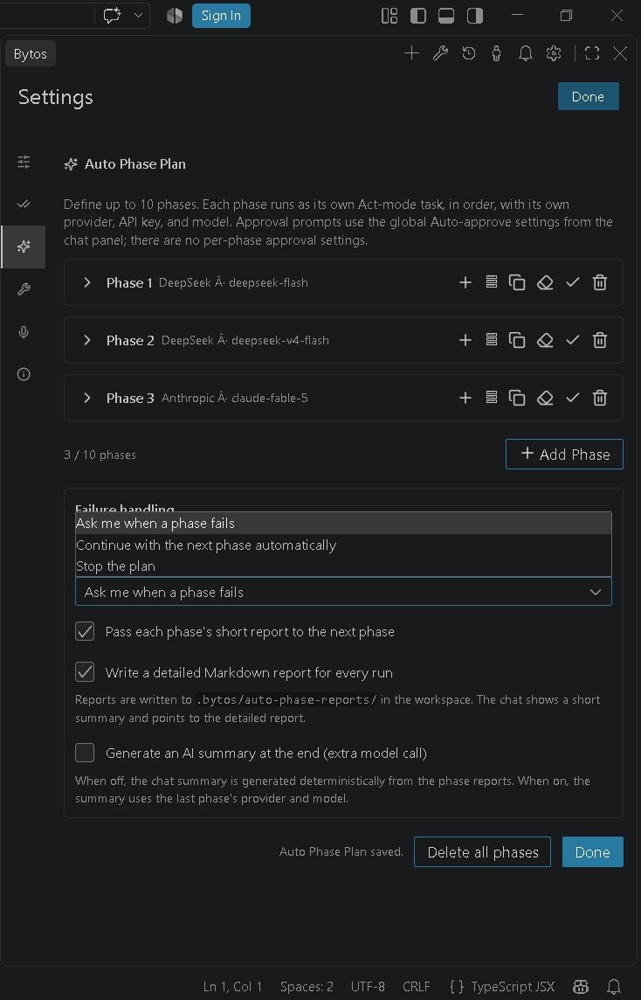
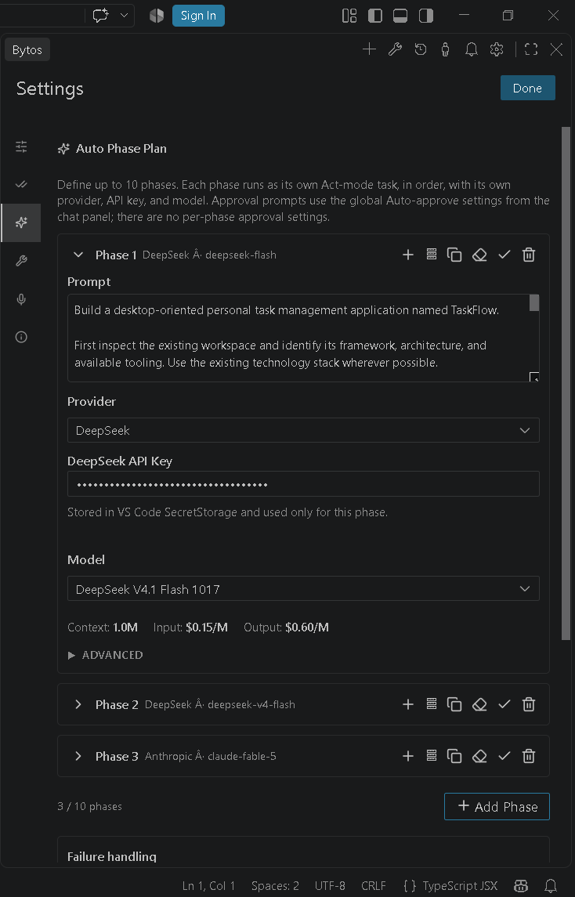

<p align="center">
  
</p>

<h1 align="center">Bytos</h1>

<p align="center">
  <strong>Open-source AI coding agent for Visual Studio Code.</strong>
</p>

<p align="center">
  <a href="LICENSE"></a>
  <a href="https://github.com/Balahurra/Bytos/actions/workflows/ext-vscode-test.yml"></a>
  <a href="apps/vscode/package.json"></a>
  
</p>

<p align="center">
  <a href="https://bytos.dev/">Website</a> |
  <a href="https://marketplace.visualstudio.com/items?itemName=Bytos.bytos">VS Code Marketplace</a> |
  <a href="https://discord.gg/2hSFZY9Bs">Discord</a> |
  <a href="docs/">Documentation</a> |
  <a href="CONTRIBUTING.md">Contributing</a> |
  <a href="SECURITY.md">Security</a> |
  <a href="https://github.com/Balahurra/Bytos/issues">Issues</a>
</p>

---

<!-- GitHub does not render relative <video> tags in READMEs: the demo is a
     clickable poster that opens the MP4 stored in this repository. -->
<p align="center">
  <a href="https://raw.githubusercontent.com/Balahurra/Bytos/main/video/Bytos-video-1.mp4" title="Watch the full Bytos demo">
    
  </a>
</p>

<p align="center">
  ▶ <a href="https://raw.githubusercontent.com/Balahurra/Bytos/main/video/Bytos-video-1.mp4"><strong>Watch the full Bytos demo (MP4)</strong></a>
</p>

<p align="center">
  <code>autonomous coding agent</code> · <code>automatic coding agent</code> ·
  <code>auto phase coding agent</code> · <code>autonomous AI agent</code> ·
  <code>VS Code AI coding assistant</code>
</p>

Bytos is a chat-first, autonomous AI coding agent for Visual Studio Code. It plans
before it edits, asks before it acts, and keeps you in control at every step. It
reads your repository, writes and refactors code, runs commands, browses the web,
and calls MCP tools with your approval.

This release is a free, **bring-your-own-key (BYOK)** build. There is no Bytos
account, subscription, or hosted backend: you connect the model provider you
already pay for. API keys are stored in VS Code SecretStorage, never in a
plaintext settings file, and are never sent to the webview.

## Why Bytos

- **Plan first, then execute.** Bytos breaks work into steps, shows the plan, and
  checks in before risky actions.
- **Whole-repository context.** File tree, symbols, diagnostics, terminal output,
  browser state, and MCP tools in one loop.
- **Fail-closed approval by default.** File reads, edits, terminal commands,
  browser access, and MCP tools require your explicit approval until you enable
  that category. Auto-approval is opt-in.
- **Bring your own key.** OpenRouter, Anthropic, OpenAI, Google Gemini, AWS
  Bedrock, Azure, GCP Vertex, Cerebras, Groq, any OpenAI-compatible endpoint, and
  local models through Ollama or LM Studio.
- **Sequential Auto Phase plans.** Define up to ten phases, each with its own
  provider, model, prompt, attachments, and MCP allowlist. Phases run one after
  another - not in parallel.
- **Local voice dictation.** Record in the composer, pick the microphone in
  Settings → Voice, and transcribe locally; audio is held in memory only.
- **Extensible.** MCP servers, hooks, skills, worktrees, checkpoints, and a typed
  SDK.

## What is in this repository

Bytos is distributed as a **Visual Studio Code extension**. Only `apps/vscode`
is packaged for the Marketplace.

| Component | Path | Distribution |
| --- | --- | --- |
| **VS Code extension** | `apps/vscode` | **The product.** Install from the [VS Code Marketplace](https://marketplace.visualstudio.com/items?itemName=Bytos.bytos) or build the VSIX with `node scripts/package-release.mjs` |
| Agent core | `sdk/packages` | Internal engine used by the extension; not published to npm yet |
| CLI, hub, desktop, examples | `apps/cli`, `apps/bytos-hub`, `apps/examples` | Workspace sources kept for development; **not included in the VSIX and not distributed in this release** |

The packaged extension contains no CLI binary and no OpenCode runtime or CLI
integration.

## Install

Install **Bytos** from the [VS Code Marketplace](https://marketplace.visualstudio.com/items?itemName=Bytos.bytos),
or build and install the verified VSIX from source:

```bash
bun install
cd apps/vscode
node scripts/package-release.mjs
code --install-extension ../../bytos-1.0.2.vsix
```

Then open the Bytos view in the activity bar.

### Configure a provider

1. Open **Settings > API Configuration**.
2. Choose a provider and paste your API key.
3. Select a model.

Your key is written to VS Code SecretStorage. The webview only receives a
length-based mask and a configured/not-configured status.

### Use the agent

Describe a task in the chat box. Bytos proposes a plan, reads the files it needs,
and asks before it edits files, runs commands, opens a browser, or calls an MCP
tool. You can review diffs, stop a task, compare checkpoints, and restore the
workspace to an earlier step.

## Auto Phase Plan mode

**Auto Phase Plan** is Bytos's sequential, automatic **10-phase orchestration**
mode. It is not a parallel multi-agent fan-out: it is one deterministic pipeline
where every phase starts only after the previous one has finished. Open the mode
selector in the chat input and choose **Auto**.

You define the plan once in **Settings → Auto Phase Plan**, then start it from the
composer. The run walks the plan for you:

1. **Up to ten ordered phases, advanced automatically.** Phase 1 starts first and
   Bytos moves to the next phase on its own until it reaches the last phase you
   configured. You do not have to use all ten: the run stops at your final phase.
   Phases always execute in order, one at a time.
2. **Every phase is its own Act-mode task.** Each phase gets a fresh task, its own
   prompt, and its own tool loop. Phase 2 does not inherit phase 1's live context.
   If you want continuity, enable **Pass each phase's short report to the next
   phase**; the next phase then receives the previous phase's completion report as
   context.
3. **Per-phase MCP, provider, model, and API key.** Each phase can use a different
   provider, model, API key, attachments, and MCP server allowlist. Route a cheap,
   fast model to scaffolding and the strongest model to the final review without
   editing global settings between phases.
4. **Phase settings are isolated.** A phase's provider, model, key, prompt,
   attachments, and MCP selection belong to that phase. When a phase finishes, its
   settings do **not** leak or jump into the next phase unless you explicitly copy
   them; the next phase starts from its own configuration. This is what makes a
   ten-phase plan predictable.
5. **Your failure policy.** If a phase fails, or reports `BLOCKED` / `FAILED`, you
   choose **Stop the plan**, **Continue with the next phase automatically**, or
   **Ask me when a phase fails**. The default is to ask. Auth, API-key, credit, and
   quota failures are never auto-continued silently.
6. **A report for every phase, and one overall summary at the end.** Every run
   writes a detailed Markdown report to
   `.bytos/auto-phase-reports/<run-id>/report.md` containing each phase's prompt,
   provider/model, status, duration, error, and completion report. After the last
   phase, Bytos composes an overall summary of the whole run — what happened in
   which phase, where it stopped, and what is left — and stores all phase summaries
   together in that Markdown file. The chat shows a short summary with a link to
   the full report, so you can audit the run without reading the transcript.
7. **Optional AI final summary.** Off by default. When enabled, the last phase's
   provider and model write the closing summary (one extra model call). When off,
   the summary is generated deterministically from the phase reports.
8. **Explicit start and a stop button.** Starting a plan shows a confirmation
   warning, and you can stop the run at any time; stopping still writes the partial
   report and marks the remaining phases as skipped.

<p align="center">
  
  
  
</p>
<p align="center">
  <sub>Auto Phase Plan: ordered phases · failure policy · a phase with its own provider, API key, and model.</sub>
</p>

Auto Phase is opt-in and separate from normal chat. Each phase is its own task, and
phases never run in parallel.

## Feature status

Available in this release:

- chat-first agent workflow with plan/act modes and per-tool approval;
- multi-provider BYOK model configuration;
- file editing with diffs, terminal execution, browser automation, and MCP tools;
- hooks, skills, worktrees, checkpoints, and task history;
- sequential Auto Phase plans with per-phase settings;
- local voice dictation: bundled whisper.cpp engine, microphone discovery,
  per-device selection, and a Turkish/English/German composer UI; speech models
  download on demand, and audio stays in memory and never leaves your machine;
- opt-in telemetry, disabled by default.

Not shipped in this release:

- CLI, hub, desktop, and example applications;
- any Bytos account, subscription, or hosted backend;
- SDK publication to npm.

## Security and privacy

- **Telemetry is off by default.** It is enabled only by an explicit opt-in in
  Settings > General. Disabling it stops PostHog events and feature flags.
- **No Bytos backend.** Model requests go from your machine to the provider you
  picked.
- **Fail-closed permissions.** Reads, edits, terminal commands, browser access,
  MCP tools, and unknown tools require approval by default.
- **Workspace boundaries.** File tools enforce a canonical workspace boundary,
  including absolute paths, traversal, Windows drive/UNC paths, and symlinks.

Read [SECURITY.md](SECURITY.md) to report a vulnerability and
[apps/vscode/PRIVACY.md](apps/vscode/PRIVACY.md) for the full data map.

## Development

Requirements: **Bun 1.4.2** and **Node.js 22+**.

```bash
bun install
bun run build:sdk                         # build the shared SDK packages
bun run types                             # typecheck every workspace
bun run test                              # unit and integration tests
bun run lint                              # Biome
cd apps/vscode
bun run test:e2e                          # Playwright end-to-end tests
node scripts/package-release.mjs          # reproducible VSIX build
```

Useful entry points:

```bash
bun run cli            # terminal UI in development mode (not distributed)
bun run code           # VS Code extension in development mode
bun run build          # build the SDK and CLI (CLI is not packaged)
```

## Repository conventions

- **Bun workspaces** for every package; no npm or yarn lockfiles.
- **Biome** for formatting and linting.
- **Vitest** and Bun's test runner for unit tests, Playwright for end-to-end tests.
- **Typed protobuf** for host/webview messages.
- **Conventional commits** and a green `bun run check` before opening a PR.

## Brand and license

Bytos is licensed under the **Apache License 2.0**. See [LICENSE](LICENSE) and
[NOTICE](NOTICE).

Bytos includes software derived from the [Cline](https://github.com/cline/cline)
open-source project, Copyright 2026 Cline Bot Inc., licensed under the Apache
License 2.0. The upstream copyright notice is preserved in [LICENSE](LICENSE);
[NOTICE](NOTICE) explains the relationship and disclaims affiliation; files
acquired from Cline and then modified by Bytos carry a
`Copyright 2026 Cline Bot Inc. | Bytos modifications` header. Every bundled
dependency and its license text is listed in
[apps/vscode/THIRD-PARTY-NOTICES.txt](apps/vscode/THIRD-PARTY-NOTICES.txt).
See [docs/release-audit/04-LICENSE-NOTICE-AUDIT.md](docs/release-audit/04-LICENSE-NOTICE-AUDIT.md)
for the full obligation map.

The Bytos name, logo, and visual identity are original to this project and are
**not** covered by the Apache license. See [TRADEMARKS.md](TRADEMARKS.md) before
using them in a fork or distribution.

## Links

- **Website:** <https://bytos.dev/>
- **GitHub:** <https://github.com/Balahurra/Bytos>
- **VS Code Marketplace:** <https://marketplace.visualstudio.com/items?itemName=Bytos.bytos>
- **Discord:** <https://discord.gg/2hSFZY9Bs>
- Documentation: [docs/](docs/)
- Issues: <https://github.com/Balahurra/Bytos/issues>
- Security: <https://github.com/Balahurra/Bytos/security/advisories/new> (see [SECURITY.md](SECURITY.md))
- Privacy: [apps/vscode/PRIVACY.md](apps/vscode/PRIVACY.md)
