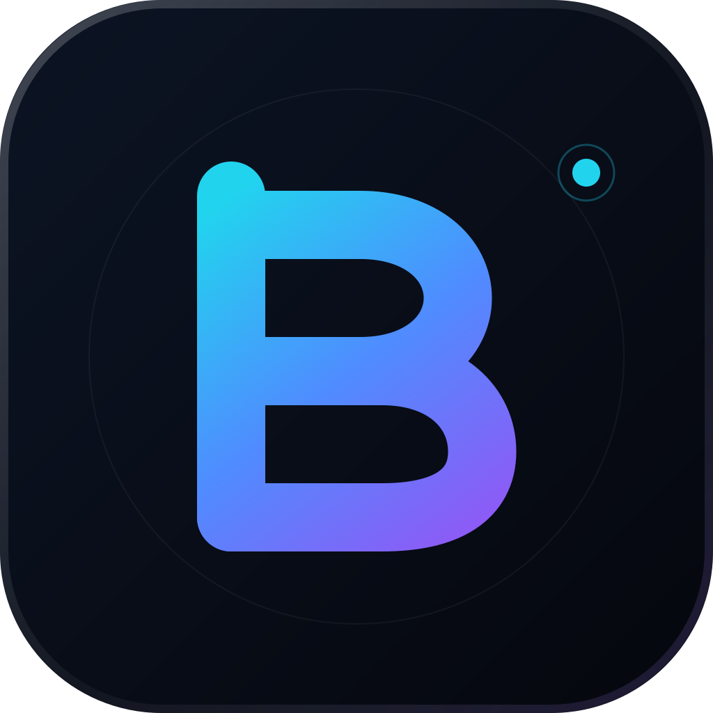

<p align="center">
  
</p>

<h1 align="center">Bytos</h1>

<p align="center">
  <strong>The open-source coding agent for your IDE, terminal, and desktop.</strong>
</p>

<p align="center">
  <a href="LICENSE"></a>
  <a href="https://github.com/Balahurra/Bytos/actions"></a>
  
  
</p>

<p align="center">
  <a href="https://github.com/Balahurra/Bytos">Docs</a> |
  <a href="https://github.com/Balahurra/Bytos/discussions">Discussions</a> |
  <a href="CONTRIBUTING.md">Contributing</a> |
  <a href="SECURITY.md">Security</a>
</p>

---

Bytos is an autonomous software engineering agent that plans before it edits, asks before it acts, and keeps you in control at every step. It reads your repository, writes and refactors code, runs commands, browses the web, and verifies its own work.

It runs everywhere you do: as a VS Code extension, a terminal UI, a desktop app, and a local browser dashboard -- all powered by the same agent core.

## Why Bytos

- **Plan first, then execute.** Bytos breaks work into steps, shows the plan, and checks in before risky actions.
- **Whole-repository context.** File tree, symbols, diagnostics, terminal output, browser state, and MCP tools in one loop.
- **Fail-closed approval by default.** File reads, edits, terminal commands, browser access, and MCP tools require your explicit approval until you enable that category. Auto-approval is opt-in.
- **One engine, every surface.** IDE, CLI, desktop, and hub share the same session model and tool runtime.
- **Built to stay fast.** Streaming responses, lazy-loaded UI, incremental context, and a native session store.
- **Extensible from day one.** MCP servers, hooks, skills, subagents, worktrees, and a typed SDK.

## Surfaces

| Surface | Package | Get started |
| --- | --- | --- |
| **VS Code** | `apps/vscode` | Install `bytos.bytos` from the Marketplace |
| **CLI** | `@bytos/cli` | `npm i -g @bytos/cli` then run `bytos` |
| **Desktop** | `apps/examples/desktop-app` | Build with Tauri, or download a release |
| **Hub** | `@bytos/bytos-hub` | `bytos hub` opens the local dashboard |
| **SDK** | `@bytos/sdk` | `npm i @bytos/sdk` |

### CLI quick start

```bash
npm i -g @bytos/cli
bytos
```

Run one task headlessly:

```bash
bytos "add retry handling to the upload service and cover it with tests"
```

### VS Code quick start

```bash
code --install-extension bytos.bytos
```

Open the Bytos view in the activity bar, pick a model provider, and describe the task.

This release is a free, bring-your-own-key (BYOK) build. It does not require a Bytos account, subscription, or backend. API keys are stored in VS Code SecretStorage, never in a plaintext settings file, and are never sent to the webview.

### ClinePass compatibility

If you already have a Cline API key, choose **ClinePass** in **Settings → API Configuration**. It calls Cline's hosted API directly (`https://api.cline.bot/api/v1`), so existing Cline users can keep their key and billing relationship. Cline's pricing and terms apply; this is a compatibility provider, not a Bytos subscription.

## Performance

The webview is the most latency-sensitive part of an IDE agent: every millisecond spent parsing code is a millisecond before the first token appears.

This fork ships with a smaller startup path:

- The initial webview bundle dropped from **10.16 MB to 5.89 MB (-42.1%)**.
- Banner icons use a small static registry instead of loading a chunk per icon, cutting the webview build from **1,588 to 72 chunks**.
- Mermaid and its diagram engines are loaded only when a conversation contains a diagram.
- PDF, DOCX, and XLSX parsers are imported only when those file types are attached.
- Heavy panels are split into on-demand chunks instead of being parsed at startup.
- Sessions stream over a typed gRPC bridge instead of polling.

These are measured on the checked-in build configuration, not marketing estimates. See `docs/` for the architecture notes.

## Architecture

```text
apps/
  vscode/          VS Code extension host, webview, protobuf bridge
  cli/             Terminal UI and headless runner
  bytos-hub/       Local browser dashboard for sessions and clients
  examples/        Desktop app, menubar app, SDK integrations
sdk/
  packages/
    core/          Agent loop, tools, sessions, checkpoints, MCP
    llms/          Provider adapters and model catalog
    agents/        Multi-agent orchestration
    shared/        Protocols, storage, prompts, utilities
    ui/            Shared React components and theme
```

The extension host never talks to providers directly. The agent core owns the loop; the host provides tools and approvals; the webview renders state. That separation is what lets the CLI, desktop app, and hub reuse the same engine.

## Development

Requirements: **Bun 1.4.2** and **Node.js 22+**.

```bash
bun install
bun run build:sdk                    # build the shared SDK packages
cd apps/vscode && bun run build:webview   # build the VS Code webview
bun run types                        # typecheck every workspace
bun run test                         # unit tests
bun run lint                         # Biome
```

Useful entry points:

```bash
bun run cli            # terminal UI in development mode
bun run code           # VS Code extension in development mode
bun run build          # build the SDK and CLI
cd apps/vscode && bun run package   # production VSIX
```

## Repository conventions

- **Bun workspaces** for every package; no npm or yarn lockfiles.
- **Biome** for formatting and linting.
- **Vitest** for unit tests, Playwright for end-to-end tests.
- **Typed protobuf** for host/webview messages.
- **Conventional commits** and a green `bun run check` before opening a PR.

## Brand and license

Bytos is licensed under the **Apache License 2.0**. See [LICENSE](LICENSE) and [NOTICE](NOTICE).

Bytos includes software derived from the [Cline](https://github.com/cline/cline)
open-source project, Copyright 2026 Cline Bot Inc., licensed under the Apache
License 2.0. The upstream copyright notice is preserved in [LICENSE](LICENSE);
[NOTICE](NOTICE) explains the relationship and disclaims affiliation; files
acquired from Cline and then modified by Bytos carry a
`Copyright 2026 Cline Bot Inc. | Bytos modifications` header. Every bundled
dependency and its license text is listed in
[apps/vscode/THIRD-PARTY-NOTICES.txt](apps/vscode/THIRD-PARTY-NOTICES.txt).
See [docs/release-audit/03-LICENSE-AND-ATTRIBUTION.md](docs/release-audit/03-LICENSE-AND-ATTRIBUTION.md)
for the full obligation map.

The Bytos name, logo, and visual identity are original to this project and are **not** covered by the Apache license. See [TRADEMARKS.md](TRADEMARKS.md) before using them in a fork or distribution.

## Links

- Source: <https://github.com/Balahurra/Bytos>
- Issues: <https://github.com/Balahurra/Bytos/issues>
- Discussions: <https://github.com/Balahurra/Bytos/discussions>
- Security: <https://github.com/Balahurra/Bytos/security/advisories/new> (see [SECURITY.md](SECURITY.md))
- Privacy: [apps/vscode/PRIVACY.md](apps/vscode/PRIVACY.md)
- Release readiness: [docs/release-audit/07-RELEASE-READINESS.md](docs/release-audit/07-RELEASE-READINESS.md)
