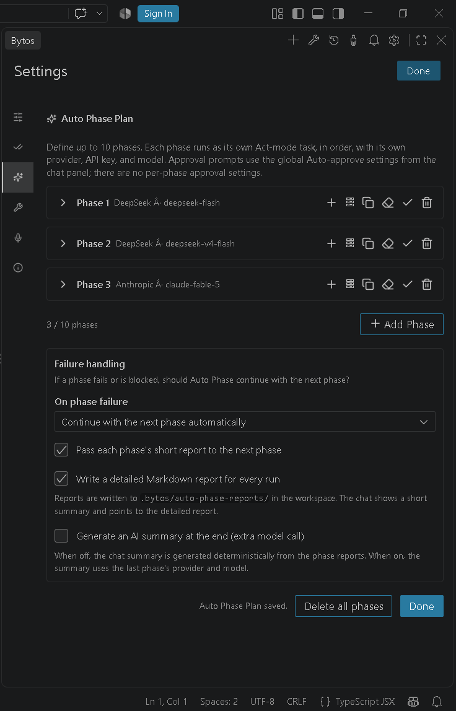

<p align="center">
  
</p>

<h1 align="center">Bytos</h1>

<p align="center">
  <strong>The open-source autonomous AI coding agent for Visual Studio Code.</strong>
</p>

<p align="center">
  <a href="https://marketplace.visualstudio.com/items?itemName=Bytos.bytos"></a>
  <a href="https://github.com/Balahurra/Bytos/actions/workflows/ext-vscode-test.yml"></a>
  <a href="LICENSE"></a>
  <a href="apps/vscode/package.json"></a>
  
</p>

<p align="center">
  <a href="https://bytos.dev/">Website</a> |
  <a href="https://marketplace.visualstudio.com/items?itemName=Bytos.bytos">VS Code Marketplace</a> |
  <a href="https://discord.gg/2hSFZY9Bs">Discord</a> |
  <a href="https://www.youtube.com/@BytosAgent">YouTube</a> |
  <a href="https://x.com/balahurra_bytos">X</a> |
  <a href="docs/">Documentation</a> |
  <a href="CONTRIBUTING.md">Contributing</a> |
  <a href="SECURITY.md">Security</a> |
  <a href="https://github.com/Balahurra/Bytos/issues">Issues</a>
</p>

---

<p align="center">
  <a href="https://www.youtube.com/watch?v=_pUIjs775ig" title="Watch the Bytos demo on YouTube">
    
  </a>
</p>

<p align="center">
  ▶ <a href="https://www.youtube.com/watch?v=_pUIjs775ig"><strong>Watch the full Bytos demo</strong></a>
  · <a href="assets/docs/bytos-demo.mp4">MP4</a>
</p>

<p align="center">
  <code>autonomous coding agent</code> · <code>automatic coding agent</code> ·
  <code>auto phase coding agent</code> · <code>autonomous AI agent</code> ·
  <code>VS Code AI coding assistant</code>
</p>

Bytos is an **open-source, bring-your-own-key (BYOK) autonomous AI coding agent
for Visual Studio Code**. It reads your repository, plans before it edits, builds
and verifies changes through reviewable diffs, terminal commands, tests, browser
state, and MCP tools — with your approval at every risky step.

There is no Bytos account, subscription, or hosted backend in this build. You
connect the model provider you already pay for. API keys are stored in VS Code
SecretStorage and are never sent to the webview.

**Auto Phase Plan** is the differentiator: up to **10 sequential phases**, each
its own Act-mode task with its own provider, model, API key, MCP allowlist, and
failure policy, followed by a Markdown report.

## Contents

- [What is Bytos?](#what-is-bytos)
- [Why Bytos](#why-bytos)
- [Auto Phase Plan](#auto-phase-plan)
- [Quick start](#quick-start)
- [How it works](#how-it-works)
- [Features](#features)
- [Providers and models](#providers-and-models)
- [MCP and extensibility](#mcp-and-extensibility)
- [Permissions and privacy](#permissions-and-privacy)
- [Configuration](#configuration)
- [Platform support](#platform-support)
- [Example workflows](#example-workflows)
- [FAQ](#faq)
- [Troubleshooting](#troubleshooting)
- [Status and roadmap](#status-and-roadmap)
- [Development](#development)
- [Contributing](#contributing)
- [Community and support](#community-and-support)
- [License and attribution](#license-and-attribution)
- [Links](#links)

## What is Bytos?

Bytos is a chat-first agent inside VS Code. It plans first, shows the proposed
steps, and asks before it edits files, runs commands, opens a browser, or calls an
MCP tool. You can review diffs, stop a task, compare checkpoints, and restore an
earlier step.

The current release is a **free BYOK build**. It does not include a CLI, desktop
app, JetBrains plugin, SDK, Kanban, hosted Bytos Provider/BytosPass billing, or
enterprise backend. See [Status and roadmap](#status-and-roadmap).

## Why Bytos

- **Plan first, then execute.** Bytos breaks work into steps, shows the plan, and
  checks in before risky actions.
- **Whole-repository context.** File tree, symbols, diagnostics, terminal output,
  browser state, and MCP tools in one loop.
- **Approval-first by default.** File reads, edits, terminal commands, browser
  access, MCP tools, and unknown tools require approval until you opt in.
- **Bring your own key.** OpenRouter, Anthropic, OpenAI, Google Gemini, AWS
  Bedrock, Azure, GCP Vertex, Cerebras, Groq, any OpenAI-compatible endpoint, and
  local models through Ollama or LM Studio.
- **Sequential Auto Phase plans.** Define up to ten phases, each with its own
  provider, model, prompt, attachments, API key, and MCP allowlist.
- **Local voice dictation.** On Windows x64, record in the composer and transcribe
  locally with the bundled whisper.cpp engine; audio stays in memory.
- **Extensible.** MCP servers, hooks, skills, worktrees, checkpoints, and task
  history.

## Auto Phase Plan

**Auto Phase Plan** is sequential multi-phase orchestration, not a parallel
multi-agent system. Open the mode selector in the chat input and choose **Auto**.

1. **Up to ten ordered phases.** Phase 1 starts first and Bytos advances
   automatically to the last phase you configured.
2. **Each phase is its own Act-mode task.** A phase gets a fresh task, its own
   prompt, and its own tool loop. It does not inherit the previous phase's live
   context.
3. **Per-phase MCP, provider, model, and API key.** Each phase can use a different
   provider, model, key, attachments, and MCP server allowlist.
4. **Phase settings are isolated.** A completed phase's settings do not leak into
   the next phase unless you explicitly copy them.
5. **Your failure policy.** On a failure or `BLOCKED` / `FAILED` report, choose
   **Stop the plan**, **Continue automatically**, or **Ask me**. Auth, API-key,
   credit, and quota failures are not silently auto-continued.
6. **Reports.** Every run writes
   `.bytos/auto-phase-reports/<run-id>/report.md` with each phase's prompt,
   provider/model, status, duration, error, and completion report. Bytos adds an
   overall summary of the run to the same Markdown file and shows a short summary
   in chat.
7. **Optional AI final summary.** Off by default. When enabled, the last phase's
   provider/model writes the closing summary.
8. **Explicit start and stop.** Starting a plan shows a confirmation warning; the
   run can be stopped at any time, and stopping still writes a partial report.

<p align="center">
  
  
  
</p>

## Quick start

**Requirements**

- Visual Studio Code **1.101.0 or newer**.
- A model provider API key, or a local Ollama/LM Studio endpoint.
- Windows x64 for local voice dictation. The core extension is tested on Windows,
  macOS, and Linux.

**Install**

1. Install [Bytos from the VS Code Marketplace](https://marketplace.visualstudio.com/items?itemName=Bytos.bytos),
   or run:

   ```bash
   code --install-extension Bytos.bytos
   ```

2. Open the Bytos view in the activity bar.
3. Open **Settings → API Configuration**, choose a provider, paste your key or
   local endpoint, and select a model.
4. Open a workspace folder and describe a task.

**First task**

> Add a `/api/health` endpoint with a test. Keep changes inside `src/` and
> `tests/`. Ask before running commands that install packages.

Review the plan, approve the actions you want, read the diff, and check the test
output. See [Quick start](docs/getting-started/quick-start.mdx) and
[Installing Bytos](docs/getting-started/installing-bytos.mdx).

**Optional: build from source**

```bash
bun install
cd apps/vscode
node scripts/package-release.mjs
code --install-extension ../../bytos-<version>.vsix
```

## How it works

1. Describe the outcome and any boundaries.
2. Bytos explores the file tree, symbols, diagnostics, and relevant files.
3. It proposes a plan and asks before file reads, edits, commands, browser
   actions, or MCP tool calls.
4. Edits arrive as reviewable diffs; commands run in a visible VS Code terminal.
5. You accept, reject, or restore a checkpoint.
6. Bytos verifies with tests/diagnostics when the task allows it.

## Features

| Area | What you get |
|---|---|
| Agent | Chat-first Plan/Act workflow, task history, stop control |
| Editing | Reviewable diffs, checkpoints, restore |
| Execution | Visible VS Code terminal, command output |
| Browser | Open pages, click, type, scroll, screenshots, console logs |
| Context | File tree, symbols, diagnostics, `@` mentions, attachments |
| Auto Phase | Up to 10 sequential phases, per-phase settings, failure policy, reports |
| MCP | Configure MCP servers and call their tools with approval |
| Customization | Bytos rules, skills, hooks, `.bytosignore`, worktrees |
| Voice | Windows x64 local dictation with bundled whisper.cpp engine |
| Privacy | SecretStorage keys, telemetry off by default, no Bytos backend |

## Providers and models

Bytos talks to providers directly with your key. Supported integrations include
OpenRouter, Anthropic, OpenAI, Google Gemini, AWS Bedrock, Azure, GCP Vertex,
Cerebras, Groq, any OpenAI-compatible endpoint, and local models through Ollama or
LM Studio.

API keys are written to VS Code SecretStorage, never to a plaintext settings file,
and are never sent to the webview. See
[Providers and models](docs/provider-config/overview.mdx).

## MCP and extensibility

- **MCP servers:** add a local or remote server, then let Bytos call its tools
  with approval.
- **Per-phase MCP:** Auto Phase Plan can restrict which MCP servers a phase may
  use.
- **Hooks:** run local scripts at lifecycle events.
- **Skills:** load reusable instructions on demand.
- **Worktrees and checkpoints:** isolate work and restore earlier states.

See [MCP overview](docs/mcp/mcp-overview.mdx) and
[Tools and approvals](docs/tools-reference/all-bytos-tools.mdx).

## Permissions and privacy

- **Fail-closed approvals.** Reads, edits, terminal commands, browser access, MCP
  tools, and unknown tools require approval by default. Auto-approval is opt-in
  per category.
- **Workspace boundaries.** File tools enforce a canonical workspace boundary,
  including absolute paths, traversal, Windows drive/UNC paths, and symlinks.
- **Telemetry off by default.** It is enabled only by an explicit opt-in in
  **Settings → General**.
- **No Bytos backend.** Model requests go from your machine to the provider you
  picked. Local models do not leave your machine.

Read [SECURITY.md](SECURITY.md) and [apps/vscode/PRIVACY.md](apps/vscode/PRIVACY.md).

## Configuration

- **Settings → API Configuration** — provider, key, model, base URL.
- **Settings → General** — approvals and telemetry.
- **Settings → Voice** (Windows x64) — microphone, language, speech model.
- **Settings → Auto Phase Plan** — phases, per-phase settings, failure policy.

See [Configuration](docs/getting-started/config.mdx) for the full map.

## Platform support

| Surface | Status |
|---|---|
| VS Code extension (Windows/macOS/Linux) | Supported |
| Local voice dictation | Windows x64 only in this release |
| Remote SSH / WSL / VS Code Web / Windows ARM voice | Not supported for voice |
| Desktop, CLI, JetBrains, SDK, Kanban, hosted billing, Enterprise | Not shipped in this release |

## Example workflows

- **Fix a failing test:** “Run the failing test, explain the cause, make the
  smallest fix, and run the suite three times. Ask before touching files outside
  `src/`.”
- **Add a feature:** “Add a settings page with validation and tests. Show me the
  plan and every diff before applying it.”
- **Refactor safely:** “Split this module without changing behavior. Run typecheck
  and tests after each step and stop if a checkpoint fails.”
- **Auto Phase:** Phase 1 explores and plans, phase 2 implements, phase 3 runs
  tests and writes the report. Give each phase its own provider/model/key if you
  want.

## FAQ

**Is Bytos free?** The extension is free and open source. It is BYOK; you pay your
provider for usage.

**Do I need a Bytos account?** No.

**Which VS Code version?** 1.101.0 or newer.

**Does it work on macOS/Linux?** The core extension is tested on Windows, macOS,
and Linux. Local voice is Windows x64 only.

**Does Bytos send code to a Bytos server?** No. Requests go directly to your
provider or local model.

**Where are keys stored?** VS Code SecretStorage.

**Are Auto Phase phases parallel?** No. They run in order, one at a time.

**Can I stop a plan on failure?** Yes: stop, continue automatically, or ask.

**Where are reports written?** `.bytos/auto-phase-reports/<run-id>/report.md`.

**How is Bytos related to Cline?** Bytos includes software derived from the Cline
open-source project under Apache-2.0. Bytos is independent and not endorsed by
Cline. See [NOTICE](NOTICE).

See the [full FAQ](docs/troubleshooting/faq.mdx).

## Troubleshooting

- [FAQ](docs/troubleshooting/faq.mdx)
- [Voice and microphone](docs/troubleshooting/voice-and-microphone.mdx)
- [Networking and proxies](docs/troubleshooting/networking-and-proxies.mdx)
- [GitHub Issues](https://github.com/Balahurra/Bytos/issues)
- [Discord](https://discord.gg/2hSFZY9Bs)

For security issues, use the private advisory link in [SECURITY.md](SECURITY.md).

## Status and roadmap

**Shipped:** VS Code extension, BYOK providers, approval-first tools, Auto Phase
Plan, MCP, rules/skills/hooks, checkpoints/worktrees, Windows x64 local voice.

**Not shipped:** Desktop, CLI, JetBrains, SDK, Kanban, Bytos Provider/BytosPass
hosted billing, Enterprise SSO/monitoring, public Bytos API.

There is no dated public roadmap yet. Follow GitHub Issues and releases; see
[Status and roadmap](docs/status-and-roadmap.mdx).

## Development

Requirements: **Bun 1.4.2** and **Node.js 22+**.

```bash
bun install
bun run build:sdk                         # build the shared SDK packages
bun run types                             # typecheck every workspace
bun run test                              # unit and integration tests
bun run lint                              # Biome
cd apps/vscode
bun run test:e2e                          # Playwright end-to-end tests
node scripts/package-release.mjs          # reproducible VSIX build
```

Useful entry points:

```bash
bun run code            # VS Code extension in development mode
bun run cli             # terminal UI in development (not distributed)
bun run build           # build the SDK and CLI (CLI is not packaged)
```

### Repository map

| Component | Path | Distribution |
|---|---|---|
| **VS Code extension** | `apps/vscode` | **The product.** Marketplace + VSIX |
| Agent core | `sdk/packages` | Internal engine; not published to npm |
| CLI, hub, desktop, examples | `apps/cli`, `apps/bytos-hub`, `apps/examples` | Workspace sources; **not in the VSIX** |

### Repository conventions

- **Bun workspaces** for every package; no npm or yarn lockfiles.
- **Biome** for formatting and linting.
- **Vitest** and Bun's test runner for unit tests; Playwright for E2E.
- **Typed protobuf** for host/webview messages.
- **Conventional commits** and a green `bun run check` before opening a PR.

## Contributing

Read [CONTRIBUTING.md](CONTRIBUTING.md) before opening a PR. Feature requests go
through the [Feature Request form](https://github.com/Balahurra/Bytos/issues/new?template=feature_request.yml);
bugs through the [Bug Report form](https://github.com/Balahurra/Bytos/issues/new?template=bug_report.yml).
See [SUPPORT.md](SUPPORT.md) for support routes.

## Community and support

- [Discord](https://discord.gg/2hSFZY9Bs)
- [GitHub Issues](https://github.com/Balahurra/Bytos/issues)
- [YouTube](https://www.youtube.com/@BytosAgent)
- [X](https://x.com/balahurra_bytos)
- [Website](https://bytos.dev/)
- [Documentation](docs/)

GitHub Discussions are not enabled at this time; use Issues or Discord.

## License and attribution

Bytos is licensed under the **Apache License 2.0**. See [LICENSE](LICENSE) and
[NOTICE](NOTICE).

Bytos includes software derived from the [Cline](https://github.com/cline/cline)
open-source project, Copyright 2026 Cline Bot Inc., licensed under the Apache
License 2.0. The upstream copyright notice is preserved in [LICENSE](LICENSE);
[NOTICE](NOTICE) explains the relationship and disclaims affiliation; files
acquired from Cline and then modified by Bytos carry a
`Copyright 2026 Cline Bot Inc. | Bytos modifications` header.

Bytos Voice bundles the whisper.cpp speech-recognition engine (release b5454),
Copyright (c) 2023-2026 The ggml authors, under the MIT License. The full license
text is in [apps/vscode/assets/voice/whisper/LICENSE.whisper.cpp.txt](apps/vscode/assets/voice/whisper/LICENSE.whisper.cpp.txt).
Every bundled dependency is listed in
[apps/vscode/THIRD-PARTY-NOTICES.txt](apps/vscode/THIRD-PARTY-NOTICES.txt).

The Bytos name, logo, and visual identity are original to this project and are
**not** covered by the Apache license. See [TRADEMARKS.md](TRADEMARKS.md) before
using them in a fork or distribution.

## Links

- **Website:** <https://bytos.dev/>
- **GitHub:** <https://github.com/Balahurra/Bytos>
- **VS Code Marketplace:** <https://marketplace.visualstudio.com/items?itemName=Bytos.bytos>
- **Discord:** <https://discord.gg/2hSFZY9Bs>
- **YouTube:** <https://www.youtube.com/@BytosAgent>
- **X:** <https://x.com/balahurra_bytos>
- Documentation: [docs/](docs/)
- Issues: <https://github.com/Balahurra/Bytos/issues>
- Security: <https://github.com/Balahurra/Bytos/security/advisories/new>
- Privacy: [apps/vscode/PRIVACY.md](apps/vscode/PRIVACY.md)
