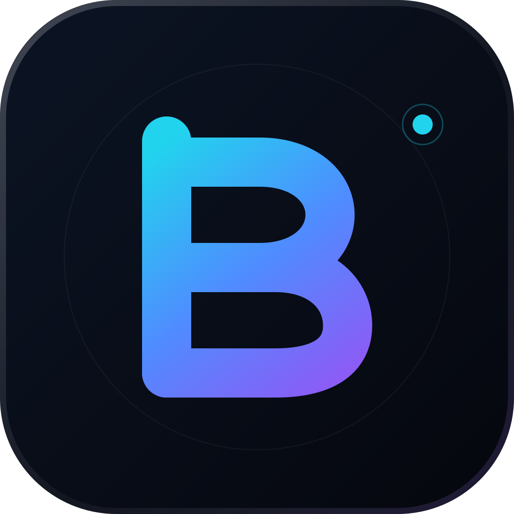
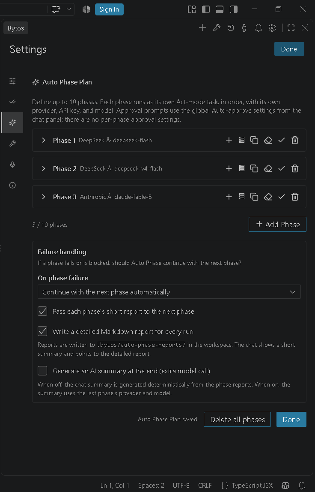
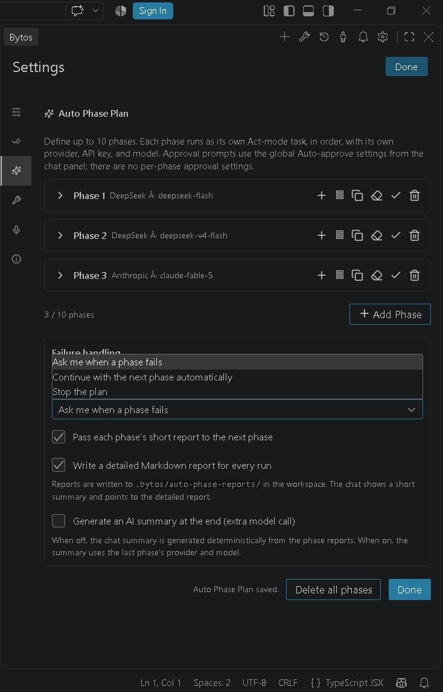
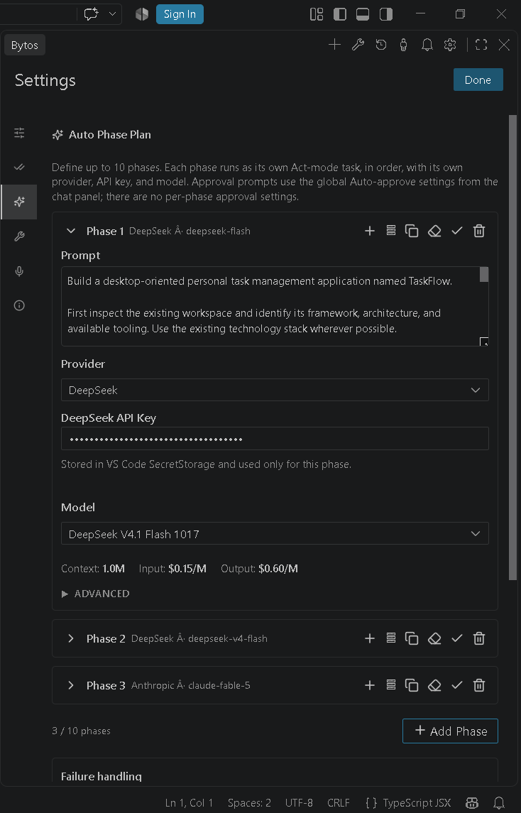

  

# Bytos

**The open-source autonomous AI coding agent for Visual Studio Code.**

Bytos reads your workspace, plans before it edits, builds and verifies changes
through reviewable diffs, terminal commands, tests, browser state, and MCP tools —
with your approval at every risky step. It is **chat-first and
bring-your-own-key**: there is **no Bytos backend**, account, subscription, or
hosted model proxy. You connect the provider you already pay for.

  

  <a href="https://bytos.dev/">Website</a> |
  <a href="https://github.com/Balahurra/Bytos">GitHub</a> |
  <a href="https://marketplace.visualstudio.com/items?itemName=Bytos.bytos">VS Code Marketplace</a> |
  <a href="https://discord.gg/2hSFZY9Bs">Discord</a> |
  <a href="https://www.youtube.com/@BytosAgent">YouTube</a> |
  <a href="https://x.com/balahurra_bytos">X</a>

> **Requirements**
>
> - **VS Code 1.101.0 or newer** (`engines.vscode` is `^1.101.0`).
> - **Your own model provider API key**, or a local Ollama/LM Studio endpoint.
> - Local voice dictation is **Windows x64 only** in this release.

## Quick start

1. Install Bytos and open the Bytos view in the activity bar.
2. Open **Settings > API Configuration**.
3. Choose a provider, paste your API key or local endpoint, and select a model.
4. Open a workspace and describe a task.

Your key is written to VS Code SecretStorage, never to a plaintext settings file,
and is never sent to the webview — the UI only receives a length-based mask.

## Auto Phase Plan

**Auto Phase Plan** is sequential multi-phase orchestration, not a parallel
multi-agent system. Up to **10 ordered phases** run automatically from phase 1 to
the last phase you configured. Each phase is its own Act-mode task with its own
prompt, provider, model, API key, attachments, and MCP allowlist. A phase's
settings do not leak into the next phase unless you explicitly copy them.

When a phase fails or reports `BLOCKED` / `FAILED`, choose **Stop the plan**,
**Continue with the next phase automatically**, or **Ask me when a phase fails**
(the default). Auth, API-key, credit, and quota failures are not silently
auto-continued.

Every run writes `.bytos/auto-phase-reports/<run-id>/report.md` with each phase's
prompt, provider/model, status, duration, error, and completion report, plus an
overall summary. The chat shows a short summary with a link to the report. An
optional AI-generated final summary is available and off by default. Starting a
plan shows a confirmation warning, and the run can be stopped at any time.

  
  
  

## What it does

- Chat-first agent with Plan / Act modes and approval-first tools.
- Reads the file tree, symbols, diagnostics, terminal output, browser state, and
  MCP tools.
- Edits files with reviewable diffs, checkpoints, and restore.
- Runs commands in a visible VS Code terminal.
- Opens pages, clicks, types, scrolls, captures screenshots and console logs.
- Configures MCP servers and calls their tools with approval.
- Supports Bytos rules, skills, hooks, and `.bytosignore`.
- Provides local voice dictation on Windows x64 with a bundled whisper.cpp engine;
  speech models download on demand.

## Providers and models

OpenRouter, Anthropic, OpenAI, Google Gemini, AWS Bedrock, Azure, GCP Vertex,
Cerebras, Groq, any OpenAI-compatible endpoint, and local models through Ollama
or LM Studio. Token usage and estimated cost are tracked per request and per task.

## Permissions and data handling

- **Fail-closed by default.** File reads, edits, terminal commands, browser
  access, MCP tools, and unknown tools require approval until you enable that
  category. Auto-approval is opt-in.
- **Keys stay in the OS credential store.** Provider API keys are written to VS
  Code SecretStorage, never to a plaintext settings file, and are never sent to
  the webview.
- **Telemetry is off by default.** It is enabled only by an explicit opt-in in
  Settings → General.
- **No Bytos backend.** Model requests go from your machine to the provider you
  picked. Local models do not leave your machine.
- **Workspace boundaries.** File tools enforce a canonical workspace boundary,
  including absolute paths, traversal, Windows drive/UNC paths, and symlinks.

The full data map is in
[PRIVACY.md](https://github.com/Balahurra/Bytos/blob/main/apps/vscode/PRIVACY.md).

## Platform support

| Surface | Status |
|---|---|
| VS Code extension (Windows/macOS/Linux) | Supported |
| Local voice dictation | Windows x64 only in this release |
| Remote SSH / WSL / VS Code Web / Windows ARM voice | Not supported for voice |
| Desktop, CLI, JetBrains, SDK, Kanban, hosted billing, Enterprise | Not shipped in this release |

## Feature status

Available in this release:

- chat-first agent workflow with Plan/Act modes and per-tool approval;
- multi-provider BYOK configuration;
- file editing with diffs, terminal execution, browser automation, and MCP tools;
- rules, skills, hooks, worktrees, checkpoints, and task history;
- sequential Auto Phase Plan with per-phase settings and Markdown reports;
- local voice dictation on Windows x64;
- opt-in telemetry, disabled by default.

Not part of this extension package:

- the CLI, hub, desktop, and example applications in the repository;
- any Bytos account, subscription, or hosted backend;
- an OpenCode runtime or CLI dependency.

## Support

- **Website:** https://bytos.dev/
- **GitHub:** https://github.com/Balahurra/Bytos
- **VS Code Marketplace:** https://marketplace.visualstudio.com/items?itemName=Bytos.bytos
- **Discord:** https://discord.gg/2hSFZY9Bs
- **YouTube:** https://www.youtube.com/@BytosAgent
- **X:** https://x.com/balahurra_bytos
- **Bugs and feature requests:** https://github.com/Balahurra/Bytos/issues
- **Security reports:** https://github.com/Balahurra/Bytos/security/advisories/new (see SECURITY.md)

## License and attribution

Bytos is licensed under the [Apache License 2.0](https://github.com/Balahurra/Bytos/blob/main/LICENSE).
Bytos includes software derived from [Cline](https://github.com/cline/cline),
Copyright 2026 Cline Bot Inc., licensed under the Apache License 2.0. The upstream
copyright notice is preserved in LICENSE and described in NOTICE. Every bundled
dependency, its declared license, license text, and copyright notice is listed in
[THIRD-PARTY-NOTICES.txt](https://github.com/Balahurra/Bytos/blob/main/apps/vscode/THIRD-PARTY-NOTICES.txt).
The Bytos name and logo are covered by
[TRADEMARKS.md](https://github.com/Balahurra/Bytos/blob/main/TRADEMARKS.md).

Bytos is an independent project. It is not endorsed by, sponsored by, or affiliated with the Cline project or its maintainers.
